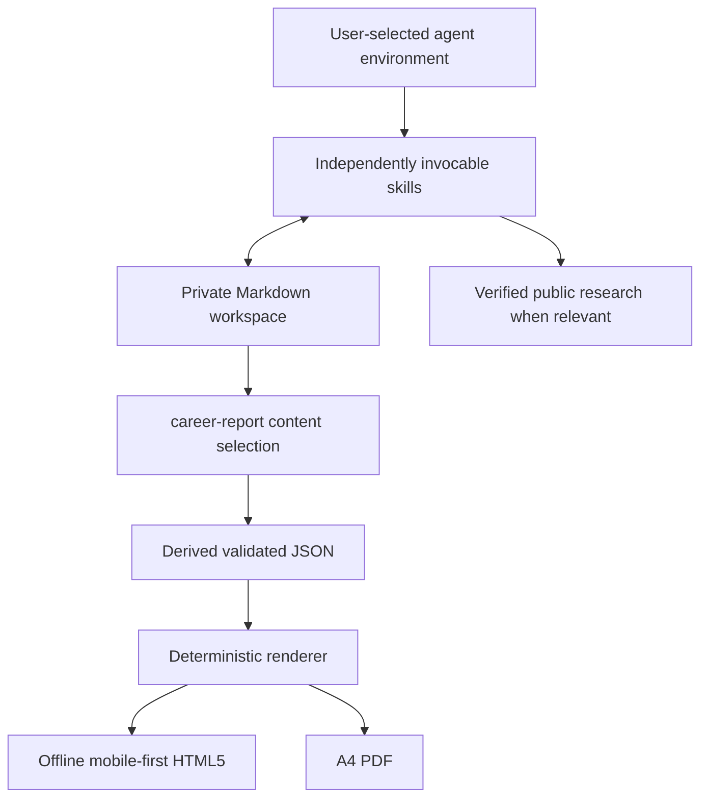

# Architecture overview

## Boundaries

Skills-first, model-independent instructions. The host agent supplies reasoning and tools; this repository supplies guidance and deterministic report utilities. There is no dedicated runtime or backend.

The report skill selects user-validated content; the renderer never revises assessments. JSON is disposable derived data, not an alternative source of truth. Skills communicate via relevant documents rather than hard dependencies or mandatory chaining.

## Execution

Load skill metadata and concise instructions, then only relevant references, workspace sections and tools. Reuse known evidence; ask or verify missing information. Environment capabilities differ: conversation-only hosts can return Markdown; file-capable hosts can save documents; execution-capable hosts can render validated HTML and PDF when dependencies are available. Explicitly disclose missing capabilities; do not claim untested compatibility.

## Privacy boundary

Workspace is outside the public project. Minimize disclosure to search/tools; use non-identifying queries. Require explicit consent for sharing sensitive content. Private reports are default; shareable reports use a reviewed allowlist of content. No built-in telemetry. Host provider processing and retention are outside project control.

## Open technical decisions

Language/runtime, packaging/install conventions per host, schema and validation implementation, score aggregation and rounding, renderer and PDF engine, fonts and permitted cover assets, version migration mechanics, evaluation thresholds and automation. Resolve these before corresponding implementation; do not treat prototype choices as accepted.
